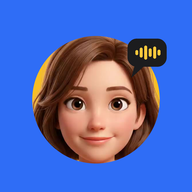
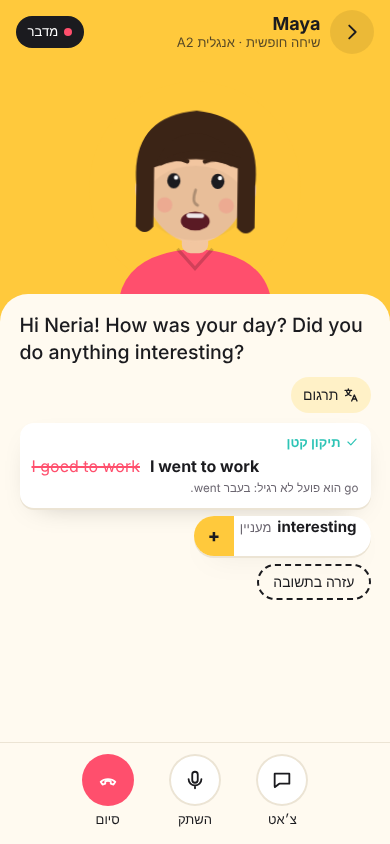
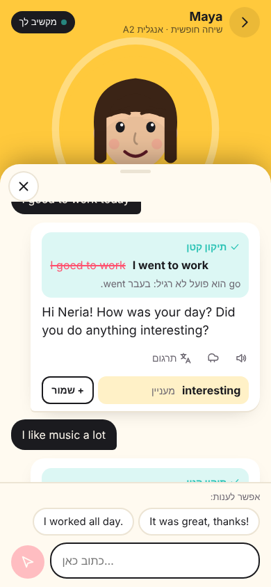
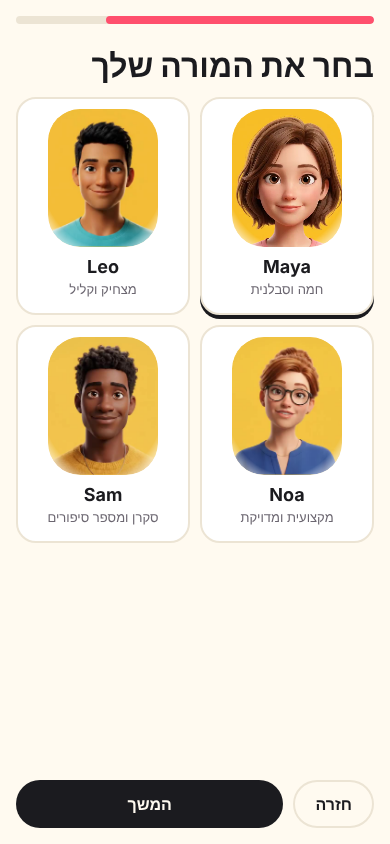
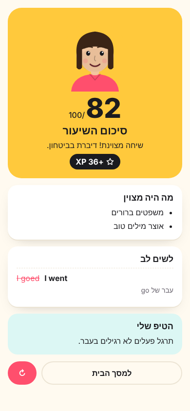

<div align="center">



# Lingo — AI Language Tutor

**Talk, don't type.** A real-time voice tutor with an animated avatar that holds natural spoken conversations, adapts to your level and interests, and quietly writes down your mistakes and new words for you.

[](https://github.com/neriaok/lingo-ai-tutor/actions/workflows/deploy-web.yml)
[](https://github.com/neriaok/lingo-ai-tutor/actions/workflows/android.yml)


[**🌐 Open the web app**](https://lingo.neriaokabik.workers.dev/) · [**📱 Download the Android APK**](https://github.com/neriaok/lingo-ai-tutor/releases/latest/download/Lingo.apk)

</div>

<p align="center">
  
  
  
  
</p>

## Why Lingo

Most "AI tutor" apps are chatbots with a microphone button bolted on. Lingo is built the other way around: **the default is a live voice call**. You speak, the tutor answers in a natural voice within a fraction of a second, and you can interrupt it mid-sentence, the way you would with a real person. Typing is there when you want it, in a pull-up chat panel.

## Features

**Conversation**
- 🎙️ **Real-time voice call** via the Gemini Live API (native audio, speech-to-speech, barge-in).
- 🧑‍🏫 **Four tutors with real personalities**: Maya is warm and patient, Noa is a sharp, probing interviewer, Leo is a friendly, down-to-earth guy, and Sam is the funny one with jokes and puns. Each has their own voice. Tutors with video clips (rendered with Gemini / Veo) cross-fade from an idle loop into a talking loop only while the tutor’s voice is audible. The drawn SVG tutors drive their mouth from the **actual amplitude** of the audio.
- 💬 **Optional chat panel**: type during a call and the tutor answers by voice. If the mic is unavailable, the app falls back to a full text chat.
- 📝 **Live captions** for both sides, with a one-tap translation into your native language.
- 🔀 **Explanation language switch**, available inside the call: everything in the target language, or keep the conversation in it while the tutor explains grammar and meanings in your native language.
- 📞 **Background calls**: switch to other apps and keep talking, like a real phone call. The phone shows mute and hang-up controls. This needs the Android app, which runs a foreground service; browsers suspend the mic of a hidden page, so the web version pauses and resumes with one tap.
- 🎵 **Songs on request**: tutors can't play audio, so they use a Gemini Live tool call to put an "open on YouTube" button on screen. The mic is muted while you listen, and afterwards you talk about the song.
- 💾 **Every conversation is saved automatically.** If a call is cut off by an incoming phone call, an app switch or a reload, you can continue exactly where you stopped. Past conversations can be re-read and resumed at any time.

**Learning**
- 🎯 **CEFR levels A1–C2** that change vocabulary, speed and sentence length, plus a **spoken placement test**.
- ❤️ **Interests and goals** (tech, music, travel, work, exams…) shape every conversation.
- 🎭 **Role-play scenarios**: café, airport, job interview, doctor, directions, shopping, friendly debate, story building.
- ✍️ **Gentle corrections**: the tutor recasts mistakes out loud, and written correction cards explain them in your language. You can choose instant, gentle or none.
- 📚 **Spaced-repetition vocabulary** (Leitner boxes). Save any new word from a call with one tap.
- 🗂️ **Mistakes notebook** that tracks repeated errors.
- 🧠 **Tutor memory**: a short recap of what you shared in recent calls, plus your saved words and open mistakes, go into the next call's instructions, so the tutor brings them up again naturally. There's also a dedicated *Practise my words* call.
- 💾 **Backup & restore** of words, mistakes, progress and conversations as copy-paste text (the API key is never included).
- 📈 **Level-up suggestions** after three strong conversations in a row.
- 🗣️ **Pronunciation help**: the tutor naturally repeats words you mispronounced.
- 📊 **Lesson summary** with a score, strengths, top mistakes and one concrete tip. XP, streaks and a daily minutes goal track progress.

**Platform**
- 🌍 6 languages in any direction (Hebrew, English, Arabic, Russian, French, Spanish), with full RTL support.
- 📲 Installable **PWA** and a signed **Android APK**, both built by CI on every push.
- 🔄 **Instant updates**: the Android app loads the live web app, so new versions arrive without reinstalling. An in-app "update now" bar appears when a new version is deployed.
- 🔐 **Bring your own free key**. The Gemini key is stored only on your device, so there's no backend and no cost.

## Getting started (users)

1. Open the [web app](https://lingo.neriaokabik.workers.dev/) or install the [APK](https://github.com/neriaok/lingo-ai-tutor/releases/latest/download/Lingo.apk).
2. Pick your languages, level, interests and tutor.
3. Create a free API key at [Google AI Studio](https://aistudio.google.com/apikey) and paste it in. It takes about a minute.
4. Tap **Call** and just talk.

> The free tier of the Gemini API has rate limits. If you hit one, wait a minute and the call can be resumed.

## Architecture

```
src/
├── components/          # FC + CSS Modules, one folder per component
│   ├── Call/            # voice-first call screen (status, captions, controls)
│   ├── ChatPanel/       # pull-up transcript + composer
│   ├── Avatar/          # SVG tutor, amplitude-driven lip-sync
│   ├── FeedbackCard/    # correction / new words / answer hints
│   ├── Onboarding/  Home/  Vocab/  Summary/  Settings/  ApiKeyForm/ …
├── features/            # Redux Toolkit
│   ├── ai/aiApi.ts      # RTK Query endpoints (chat turn, per-turn feedback, summary)
│   ├── profile/  session/  progress/  history/   # history is synced by a listener middleware
├── services/
│   ├── gemini/liveTutor.ts  # Live API session: mic in, audio out, captions, resumption
│   ├── gemini/text.ts       # JSON generation for feedback & summaries
│   ├── audio/mic.ts         # AudioWorklet → 16 kHz PCM16
│   ├── audio/player.ts      # gapless 24 kHz PCM playback + analyser
│   ├── audio/mouth.ts       # shared mouth-openness signal for the avatar
│   └── tutorPrompt.ts       # system instructions (persona, level, memory)
└── data/                # languages, levels, tutors, scenarios, UI strings
```

**How a voice turn flows**

1. `mic.ts` streams 16 kHz PCM chunks to Gemini Live over WebSocket.
2. The model streams 24 kHz audio back. `player.ts` schedules it gaplessly, and its `AnalyserNode` feeds the avatar's mouth every frame.
3. If you start speaking, the server sends `interrupted` and playback stops instantly (barge-in).
4. Input and output transcriptions become captions. On `turnComplete`, a text model returns structured feedback (translation, correction, new words, hints), which RTK Query attaches to the message.
5. Sessions use context-window compression and **session resumption**, so long calls survive server `goAway` messages.

**Tech:** React 18 · TypeScript (strict) · Redux Toolkit + RTK Query · CSS Modules · Vite · vite-plugin-pwa · Capacitor 8 · `@google/genai`.

## Development

```bash
npm install
npm run dev          # http://localhost:5173
npm run lint         # ESLint (typescript-eslint + react-hooks)
npm run typecheck
npm test             # Vitest: SRS, mistakes, prompts/personalities, backup
npm run build        # dist/ (PWA)
npm run android:sync # build + copy into the Android project
```

## CI/CD

| Workflow | Trigger | Output |
|---|---|---|
| `ci.yml` | pull request | Lint, type-check, unit tests and build |
| `deploy-web.yml` | push to `main` | Lint, type-check, tests and build; keeps the old GitHub Pages address redirecting to the new one |
| `android.yml` | push to `main` | Builds a signed release APK and publishes it as a GitHub Release (`Lingo.apk`) |

**Hosting.** The web app is served from Cloudflare Workers static assets (`wrangler.jsonc`) at <https://lingo.neriaokabik.workers.dev/>. Cloudflare Workers Builds deploys it on every push to `main` (`npm run build` → `npx wrangler deploy`), and deploys the reminder worker in `worker/` the same way.

APK signing uses four repository secrets: `ANDROID_KEYSTORE_BASE64`, `ANDROID_KEYSTORE_PASSWORD`, `ANDROID_KEY_ALIAS` and `ANDROID_KEY_PASSWORD`. Without them, CI falls back to a debug key.

## Privacy

There is no server. Your profile, progress and API key stay in your browser's local storage. Audio goes directly from your device to Google's Gemini API under your own key.

## License

[MIT](LICENSE) © Neria Okbi
